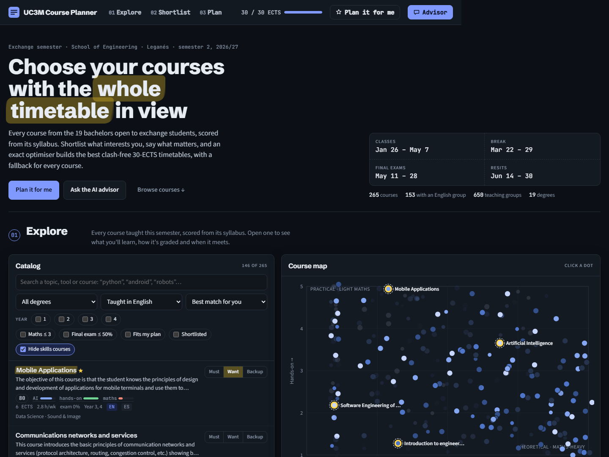
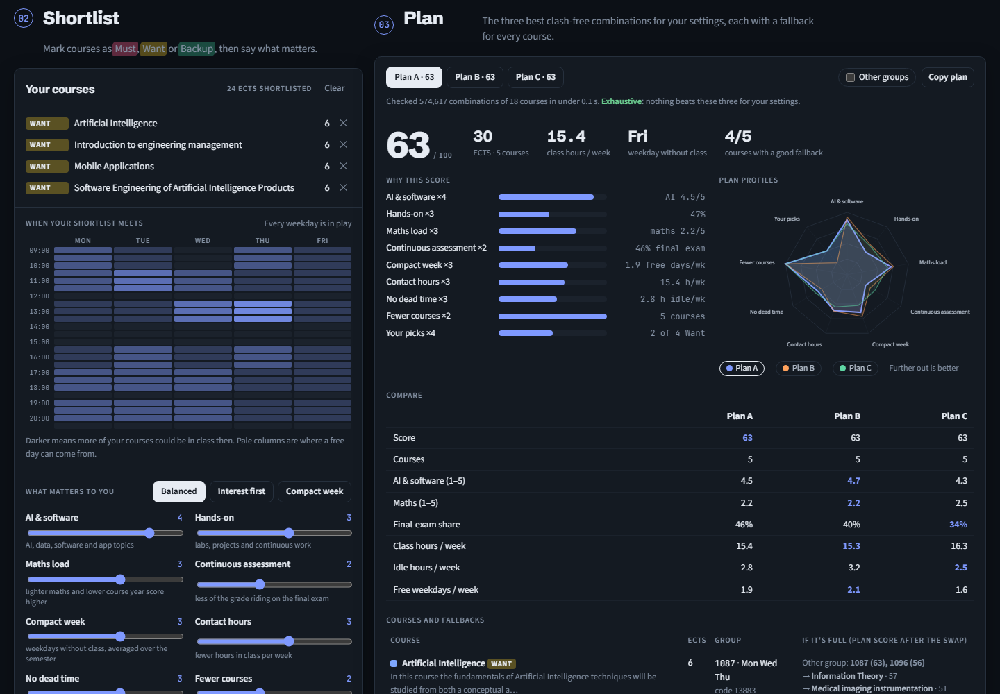
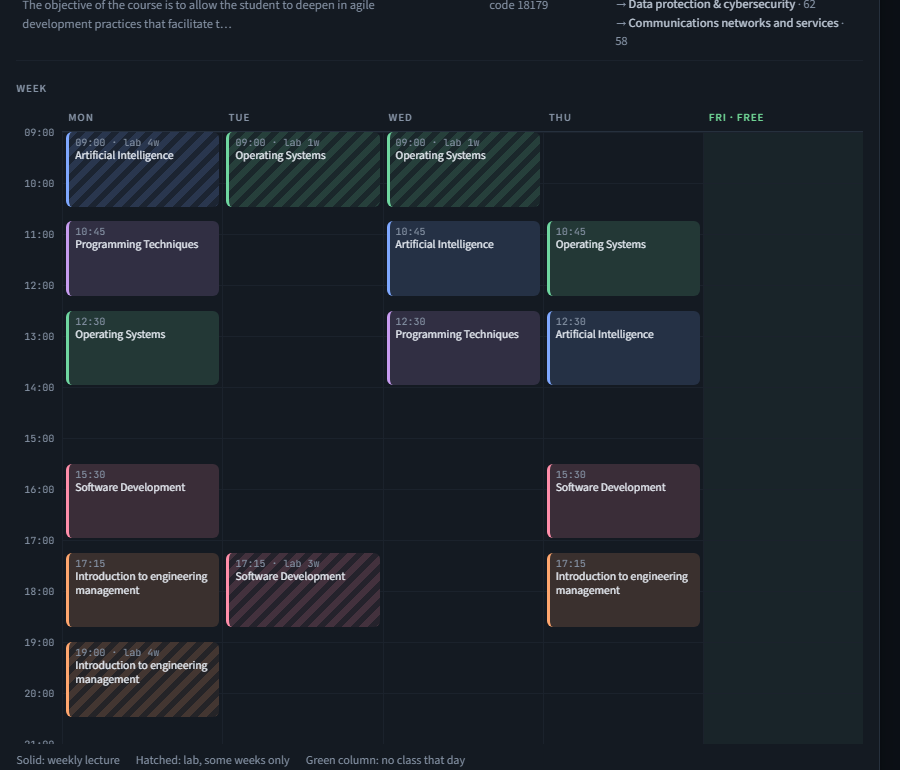
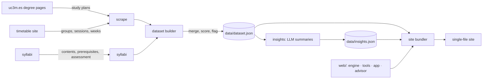

# UC3M Course Planner

[](https://github.com/Polluxgnr/uc3m-course-planner/actions/workflows/ci.yml)

**Open it: https://polluxgnr.github.io/uc3m-course-planner/** · [Student guide](docs/GUIDE.md) · [How the model works](docs/MODEL.md)

Choosing courses for an exchange semester at **Universidad Carlos III de Madrid** means juggling 19 degree
pages, a separate timetable site, hundreds of syllabi and a Learning Agreement that needs fallbacks.
This project pulls all of it into one page, then helps you decide.



## What it does

- **Knows the whole semester.** It scrapes every bachelor open to exchange students at the School of
  Engineering (Leganés): study plans, every teaching group's sessions week by week, and each syllabus.
  That's 265 courses and 650 groups.
- **Reads the syllabi for you.** Every course is scored for maths load, hands-on work, and AI and software
  focus, and tagged with its final-exam share and deadline weeks. Optional AI summaries say what you'll
  learn and what it's useful for.
- **Finds the best timetable, provably.** An exact branch-and-bound optimiser searches every clash-free
  combination that reaches your ECTS target and returns the three best plans for *your* weights. The page
  says when the search is exhaustive.
- **Plans for things going wrong.** Every course in a plan comes with ranked fallbacks: other groups, or
  replacement courses that still fit, each scored by the whole plan after the swap.
- **Three ways in:**
  - **Plan it for me:** seven quick questions, no account or key, and a drafted semester with a
    plain-language reason for every pick.
  - **AI advisor:** a chat that searches the catalog, reads syllabi, edits your shortlist and runs the
    optimiser through tool calls. Bring your own OpenRouter key.
  - **Do it yourself:** mark courses Must, Want or Backup and tune nine sliders.



## Visualisations

| View | Answers |
| --- | --- |
| Course map (maths × hands-on, coloured by AI focus, hover cards) | Where are the practical, low-maths, AI-heavy courses? |
| "When your shortlist meets" heat map | Which weekdays can I realistically keep free? |
| Score breakdown and plan-profile radar | Why does plan A beat plan B, criterion by criterion? |
| Plan comparison table | Which plan wins on hours, exams, maths, free days? |
| Week grid (weekly lectures solid, labs hatched, other groups dashed) | What does my week actually look like? |
| Semester strip | Which weeks are heavy, when are the deadlines, how much rides on finals? |
| Side-by-side course compare | Machine Learning or Artificial Intelligence? |

<p align="center"></p>

## How it works



| Piece | What it does |
| --- | --- |
| `src/uc3m_planner/parsers.py` | Pure HTML → data parsers, including the timetable grid (rowspans and colspans → weekday and time) |
| `src/uc3m_planner/http.py` | Cached, retrying, concurrent fetcher that decodes the site's mislabelled encodings |
| `src/uc3m_planner/dataset.py` | Merges the same course across degrees, keeps the teaching language per group, maps dates to teaching weeks |
| `src/uc3m_planner/scoring.py` | Bilingual keyword heuristics, rank-scaled to 1–5 across the catalog |
| `src/uc3m_planner/insights.py` | Optional LLM pass: validated JSON summaries per course, cached by input hash |
| `web/engine.js` | Scoring model plus branch-and-bound optimiser. Pure functions that run in the page, a Web Worker and Node tests |
| `web/tools.js` | The advisor's tools (search, details, shortlist, preferences, optimise) and the wizard's logic, all tested |
| `web/advisor.js` | Chat client with a tool-calling loop over OpenRouter |
| `web/app.js` | The interface and its visualisations |

**The model** ([details](docs/MODEL.md)):

- **Score:** a plan's score is a weighted average of nine criteria, each scaled to 0–1: AI and software,
  hands-on, maths load, continuous assessment, compact week, contact hours, dead time, number of courses,
  and your picks.
- **Hard constraints:** the ECTS window, Must courses, the hours you'll be on campus, days kept free, and
  the teaching language.
- **Search:** clashes and idle time are computed on 64-bit masks of 15-minute bins per week-day, at roughly
  150k partial plans per second. The bound is optimistic per criterion, so it never prunes a plan that
  could make the top three.

**The AI split:** the language model decides *what to aim for* (interests, trade-offs, explanations). The
optimiser decides *what is feasible*. So the advisor can't recommend a plan that clashes or misses 30 ECTS.

## Development

Requires Python 3.10+ and Node 18+.

```bash
pip install -e ".[dev]"
```

```bash
python -m uc3m_planner all
```

That runs scrape (about 10 min, cached), syllabi, dataset and site in order. Other commands:

```bash
python -m uc3m_planner site
```

Rebuilds `dist/` from the committed data only. Open `dist/index.html`, or serve it with
`python -m http.server -d dist`.

```bash
python -m uc3m_planner insights
```

Generates the AI course summaries. Put `OPENROUTER_API_KEY` in `.env` first (see `.env.example`).

```bash
pytest -q && ruff check src tests && node --test web/tests/engine.test.mjs web/tests/tools.test.mjs
```

Each step runs on its own: `scrape`, `syllabi`, `dataset`, `insights`, `site`. `--refresh` bypasses the HTTP
cache in `.cache/`. Only `data/` is versioned: the crawl output and full syllabus text stay local.

**Next year:** everything that changes yearly lives in [`config.py`](src/uc3m_planner/config.py): year,
semester, campus, degrees, the timetable plans the degree pages forget to link, and the calendar.

### Engineering notes

- **Tests** (Python and Node):
  - parsers against minimal HTML shaped like the real pages;
  - the engine on synthetic catalogues, and on real data against a brute-force search;
  - the incremental scoring inside the search against the reference metrics;
  - every advisor tool, and the wizard's picks;
  - insight parsing and caching with a fake LLM client.
- **CI** runs ruff, pytest and the Node tests, then builds the site. Pages deploys on every push to `main`.
- **Responsiveness:**
  - the search runs in a Web Worker built from the inlined engine source;
  - stale results are dropped when you change something mid-search;
  - a watchdog falls back to the main thread if the worker never answers.
- **Keys and privacy:**
  - the advisor's key lives in the visitor's own browser and goes only to openrouter.ai;
  - the insights key lives in a git-ignored `.env`;
  - the site has no backend and stores nothing.

## Limitations

- **Course scores and AI summaries are estimates** from syllabus text. Use them to narrow down, then read the syllabus.
- **Teaching language per group** is inferred from the degree each group belongs to. UC3M doesn't publish it.
- **Exam dates** for the semester weren't published when the data was fetched. The final-exam share and
  syllabus deadline weeks are used instead.
- **Eligibility** of a course for exchange students is up to UC3M and your home university.

Not affiliated with UC3M. Course data comes from UC3M's public pages; check them before you enrol.

## License

MIT for the code (see [LICENSE](LICENSE)). The course data belongs to UC3M.
