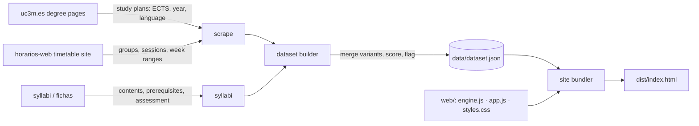

# UC3M Course Planner

[](https://github.com/Polluxgnr/uc3m-course-planner/actions/workflows/ci.yml)

Choosing courses for an exchange semester at **Universidad Carlos III de Madrid** means juggling 19 degree
pages, a separate timetable site, hundreds of syllabi and a Learning Agreement that needs fallbacks.
This project pulls all of it together.

- **Scrapes** every bachelor open to exchange students at the School of Engineering (EPS, Leganés): the
  study plans, every teaching group's timetable (week by week) and each course's syllabus.
- **Scores** every course from its syllabus: maths load, hands-on share, AI and software focus, and the
  final-exam share of the grade.
- **Optimises**: given your shortlist and what matters to you, it searches every clash-free combination
  that reaches your ECTS target and returns the three best plans, each with a score breakdown.
- **Plans for things going wrong**: for every course in a plan, it lists the other groups and replacement
  courses that still fit, ranked by the plan score after the swap.

It ships as a **single HTML file** with no backend and no install. The optimiser runs in a Web Worker and
finishes a full search in a few seconds.

> Using it to pick your courses? Read the **[student guide](docs/GUIDE.md)**.

## How it works



| Piece | What it does |
| --- | --- |
| `src/uc3m_planner/parsers.py` | Pure HTML → data parsers, including the timetable grid (rowspans and colspans → weekday and time) |
| `src/uc3m_planner/http.py` | Cached, retrying, concurrent fetcher; decodes the site's mislabelled encodings correctly |
| `src/uc3m_planner/dataset.py` | Merges the same course across degrees, keeps the teaching language per group, converts dates to teaching weeks |
| `src/uc3m_planner/scoring.py` | Bilingual keyword heuristics, rank-scaled to 1–5 across the catalog |
| `web/engine.js` | Scoring model plus a branch-and-bound optimiser over (course, group) choices. Pure functions that run in the page, a Web Worker and Node tests |
| `web/app.js` | The interface: course map, catalog, shortlist, weights, plans, week grid and semester timeline |

The model and the search are described in **[docs/MODEL.md](docs/MODEL.md)**. In short:

- **Score:** a plan's score is a weighted average of nine criteria, each scaled to 0–1: AI and software
  focus, hands-on work, maths load, continuous assessment, compact week, contact hours, dead time between
  classes, number of courses, and your own picks. You set the weights.
- **Hard constraints:** the ECTS window, Must courses, the hours you're willing to be on campus, days you
  keep free, and the teaching language.
- **Search:** clashes and idle time are computed on 64-bit masks of 15-minute bins per week-day. The search
  explores about 150k partial plans per second, and the bound never prunes a plan that could make the top 3.
  The page tells you whether the search was exhaustive or stopped at its time limit.

## Development

Requires Python 3.10+ and Node 18+ (Node is only needed for the engine tests).

```bash
pip install -e ".[dev]"
```

```bash
python -m uc3m_planner all          # scrape (~10 min, cached) → syllabi → dataset → site
```

```bash
python -m uc3m_planner site         # rebuild dist/ from the committed dataset only
```

Open `dist/index.html` in a browser, or serve it with `python -m http.server -d dist`.

```bash
pytest -q && ruff check src tests && node --test web/tests/engine.test.mjs
```

Each step can run on its own: `scrape`, `syllabi`, `dataset`, `site`. Add `--refresh` to bypass the HTTP
cache in `.cache/`. Only `data/dataset.json` is versioned: the crawl output and the full syllabus text stay local.

### Updating for another year or semester

Everything that changes yearly lives in [`src/uc3m_planner/config.py`](src/uc3m_planner/config.py):
academic year, semester, campus, the list of degrees, timetable plans the degree pages forget to link,
and the semester calendar. Update it, then run `python -m uc3m_planner all --refresh`.

### Engineering notes

- **Tests:** parsers are tested against minimal HTML shaped like the real pages. The engine is tested on
  synthetic catalogues with exact expectations. On the real data, a test checks that the optimiser's best
  plan equals a brute-force search, and that the incremental scoring used inside the search matches the
  reference metrics.
- **CI** runs ruff, pytest and the Node engine tests, then builds the site. Another workflow deploys it to
  GitHub Pages when the repository is public.
- **Responsiveness:** the optimiser runs in a Web Worker built from the inlined engine source, and stale
  results are dropped when you change something mid-search.

## Limitations

- **Course scores are heuristics,** not ground truth. They are good for sorting a 265-course catalog, but
  read the syllabus before you commit.
- **Teaching language per group** is inferred from the degree each group belongs to. UC3M doesn't publish
  it per group.
- **Exam dates** for the semester aren't in the data. The planner uses the final-exam share and the
  milestone weeks named in each syllabus.
- **Eligibility:** whether a course is open to you as an exchange student is up to UC3M and your home
  university.

Not affiliated with UC3M. Course data comes from UC3M's public pages; check them before you enrol.

## License

MIT for the code (see [LICENSE](LICENSE)). The course data belongs to UC3M.
